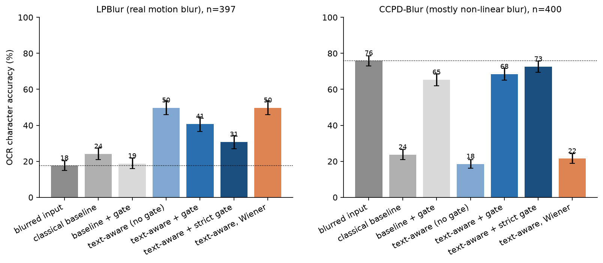
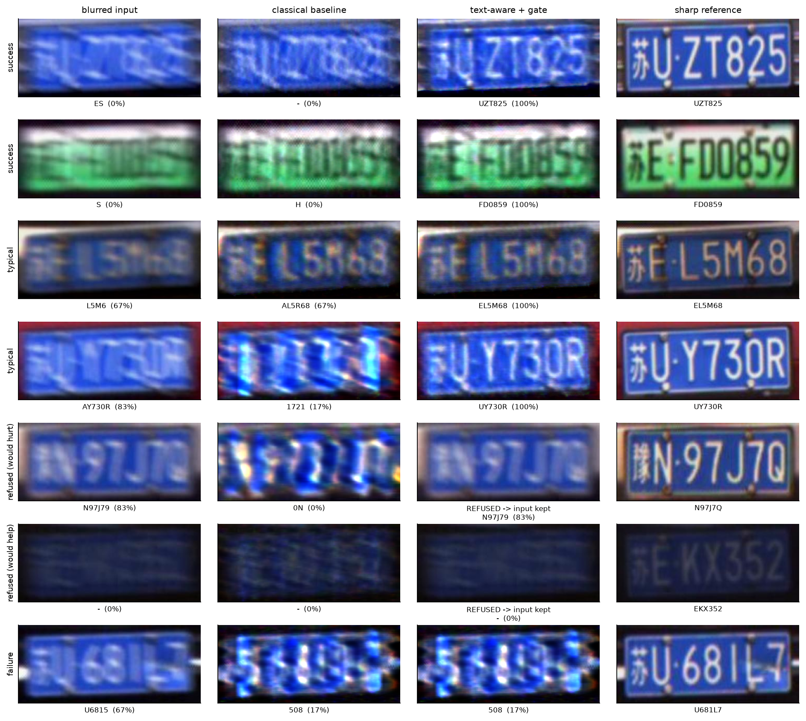

# Seeing Through the Shake

**Text-aware PSF estimation for blind motion deblurring of license plates and low-texture text.**
Digital Image Processing course project — Inesh Roy (2024112015), Maithily Gauravkumar Bhala (2024117011).

A fully classical, training-free pipeline: the blur angle and length are read off the image's own
spectrum (Radon transform + cepstrum), a confidence gate decides whether that estimate is
trustworthy, and Richardson–Lucy deconvolution restores the image — or the input is returned
unchanged with an explicit "not confident" verdict. No neural network is part of the pipeline; OCR is
used only as a measuring instrument.

```
blurred image ─► log-spectrum ─► Radon transform ─► 1-D FFT per projection ─► (angle × lag) cepstrum map
                  (band-limited,                     = radial cepstrum           deepest negative dip
                   3 bands)                                                      = (θ, L) + confidence
                                                                                        │
                       ┌──────────────── gate: dip depth, directional contrast, ───────┘
                       │                 split-half agreement
                       ▼
          refuse → input unchanged        accept → Richardson–Lucy (unknown-boundary) with line PSF(θ, L)
```

## Results at a glance

All numbers are from held-out test images; every design choice was made on separate development
splits. Full tables: [`docs/report/report.pdf`](docs/report/report.pdf) and `results/csv/`.

**Real motion-blurred plates (LPBlur, 397 test pairs), OCR character accuracy**

| system | accuracy | plates read exactly | plates made worse | PSNR / SSIM |
|---|---|---|---|---|
| blurred input | 0.176 | 3.3% | – | 21.62 / 0.642 |
| classical baseline (Radon + cepstrum + RL) | 0.241 | 7.1% | 19.1% | 20.09 / 0.581 |
| **text-aware** (multi-band estimator) | **0.497** | **25.4%** | 9.8% | 21.08 / 0.657 |
| **text-aware + gate** | 0.407 | 19.9% | **0.8%** | **21.95 / 0.682** |

**CCPD-Blur (400 test images, blur mostly *not* linear motion)**: leaving the images alone gives
0.759; deblurring every image with a line kernel drops it to 0.19–0.24. The gate refuses 82% of
the images and recovers 0.684 (strict operating point: 0.726). It does not beat doing nothing on
this set.

**Synthetic sweep (8 angles × 5 lengths × 4 noise levels)**: PSF estimation success in a plate-sized
window is 98.9% for printed text, 89.4% for plates, 80.7% for natural texture (93.0% at full frame).
The difficulty is region size, noise and short blur, not text content. The proposal's edge-enhanced
pre-processing (LCN + Laplacian) lowers success to 46.5%. On held-out trials the gate refuses 96–100%
of harmful restorations.

**Köhler camera shake**: real hand shake is curved; even the best straight-line fit to the recorded
kernel loses 1 dB (24.4 → 23.4 dB, recorded kernel 29.2 dB), which marks the limit of the
one-straight-line model.





## Repository layout

| Path | Contents |
|---|---|
| `textdeblur/` | the library (pure NumPy/SciPy/OpenCV) |
| `textdeblur/psf.py` | linear motion PSF by area sampling |
| `textdeblur/estimate.py` | joint Radon–cepstrum estimator, band limits, multi-band search; `BASELINE`, `TEXT_AWARE` |
| `textdeblur/radon_angle.py` | textbook two-stage rule (Radon-variance angle, then cepstral length), kept as a reference |
| `textdeblur/preprocess.py` | the contrast/edge pre-processing operators that were evaluated |
| `textdeblur/gate.py` | confidence gate, split-half consistency, ROC / calibration utilities; `DEFAULT_GATE` |
| `textdeblur/deconv.py` | unknown-boundary Richardson–Lucy (discrepancy stopping, optional TV), Wiener, noise estimate |
| `textdeblur/pipeline.py` | `deblur` (blind), `deblur_with_psf` (semi-blind) |
| `textdeblur/metrics.py`, `ocr.py`, `data.py` | metrics, evaluation-only OCR, dataset readers |
| `experiments/` | one script per experiment, `run_all.py` regenerates everything |
| `results/` | CSV tables, figures and logs produced by the experiments |
| `demo/` | Streamlit app (blurred \| estimated PSF + confidence \| restored) and sample images |
| `docs/` | execution plan, design decisions, report and slides |
| `tests/` | unit and integration tests (`pytest`) |
| `phase0_sanity_check/` | the phase-0 feasibility study that motivated the design |

## Setup

Python 3.10+ (developed on 3.12).

```bash
python -m venv .venv
. .venv/Scripts/activate          # Windows (Git Bash);  source .venv/bin/activate on Linux/macOS
pip install -e ".[ocr,demo,dev]"
pytest                            # 66 tests
```

## Quick start

```python
from textdeblur.data import imread
from textdeblur.pipeline import deblur

res = deblur(imread("demo/samples/synthetic_motion_plate_L17_20deg.png"))
print(res.accepted, res.reason)                  # gate verdict
print(res.estimate.angle, res.estimate.length)   # estimated PSF
restored = res.restored                          # input unchanged if refused
```

Interactive demo (automatic, semi-blind and simulate modes):

```bash
streamlit run demo/app.py
```

## Data

All datasets are public; none are redistributed here except the small CCPD-derived demo samples
(CCPD is MIT-licensed). Everything goes under `data/` (or set `TEXTDEBLUR_DATA`).

| Dataset | Use | How to get it |
|---|---|---|
| Kodak (24 images) | natural-image sources for the sweeps | `curl -o data/kodak/kodimNN.png https://r0k.us/graphics/kodak/kodak/kodimNN.png` for NN = 01…24 |
| CCPD2019 | sharp plates (`ccpd_base`, synthetic sources) and real blurred plates (`ccpd_blur`, 20,611 images) | stream the archive through `scripts/fetch_ccpd_subset.py` (keeps all of `ccpd_blur` and a deterministic 1/60 of `ccpd_base`; the 13 GB archive is never stored): `curl -L https://huggingface.co/datasets/htkien95/ccpd2019/resolve/main/CCPD2019.tar.xz \| python scripts/fetch_ccpd_subset.py --out data/ccpd --base-every 60` (also on Zenodo, record 15647076) |
| LPBlur | real motion-blurred plates with paired sharp images | `LPBlur.zip` from the LPDGAN repository (<https://github.com/haoyGONG/LPDGAN>), unzipped to `data/lpblur/LPBlur/{blur,sharp}` |
| Köhler et al. 2012 | real camera shake with recorded kernels and sharp frames | the benchmark files (`BlurryImages.zip`, `KernelsAsMat.zip`, `GroundTruth_pngs_Image{1..4}.zip`) into `data/kohler/`, then `python scripts/prepare_kohler.py` |

Printed-text sources are rendered by `textdeblur.data.render_text_page` (deterministic).

## Reproducing the results

```bash
python experiments/run_all.py           # all experiments, ~2-3 h on a 16-core laptop
python experiments/run_all.py 02 05     # selected ones
```

| Script | Proposal objective | What it measures |
|---|---|---|
| `00_design_dev.py` | design | development-split evidence for every design choice |
| `01_true_psf_check.py` | O1 | restoration with the *true* PSF: RL iterations vs. noise, boundary handling, Wiener |
| `02_characterization_sweep.py` | O1, O2 | angle × length × noise sweep: natural (full frame and plate-sized crop) vs. text vs. plates |
| `03_preprocess_comparison.py` | O3 | every pre-processing / band-limit variant on the same sweep (test split) |
| `04_gate_calibration.py` | O4 | gate signals, calibration on dev data, harm avoided vs. good withheld |
| `05_real_plates.py` | O5 | LPBlur and CCPD-Blur: OCR accuracy before/after, baseline vs. text-aware ± gate, Wiener |
| `06_kohler.py` | O1 | Köhler benchmark: recorded vs. estimated kernels, benchmark PSNR |
| `07_gallery.py` | D3 | worked example and qualitative galleries including gate refusals |

Design choices were made on development splits; every reported number comes from disjoint test
images. Random seeds are derived from the trial description, so reruns are identical.

## Documentation

* [`docs/EXECUTION_PLAN.md`](docs/EXECUTION_PLAN.md) — requirements traced from the proposal, milestones
* [`docs/DESIGN_DECISIONS.md`](docs/DESIGN_DECISIONS.md) — what was tried, what was kept, and why
* [`docs/report/report.pdf`](docs/report/report.pdf) — final report
* [`docs/slides/slides.pdf`](docs/slides/slides.pdf) — presentation
