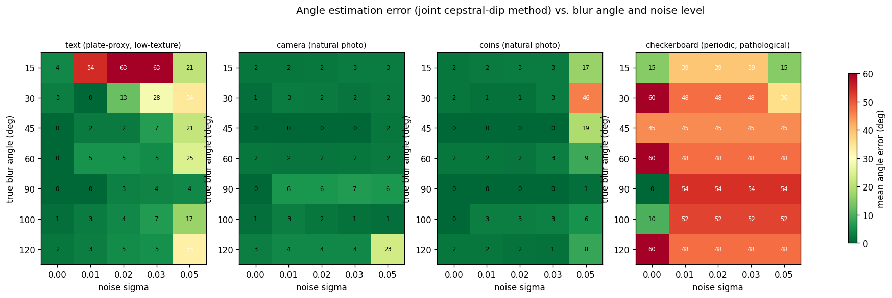
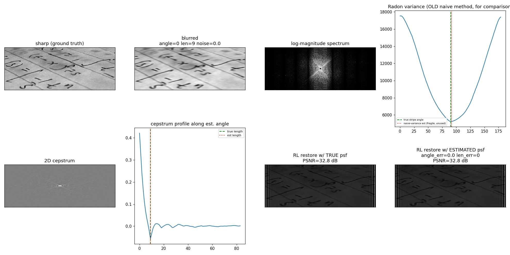
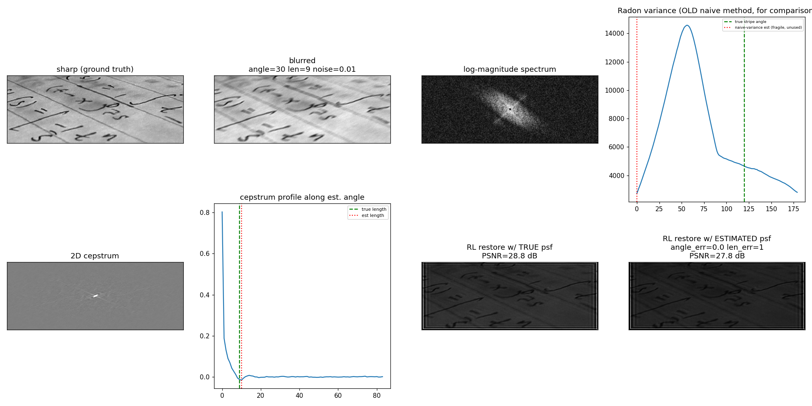
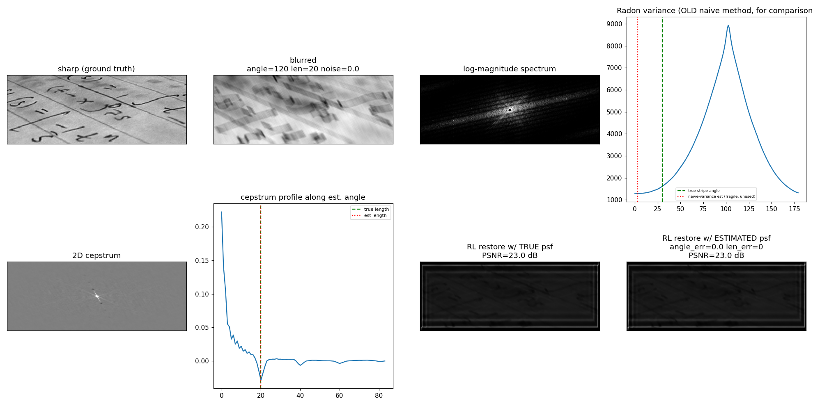
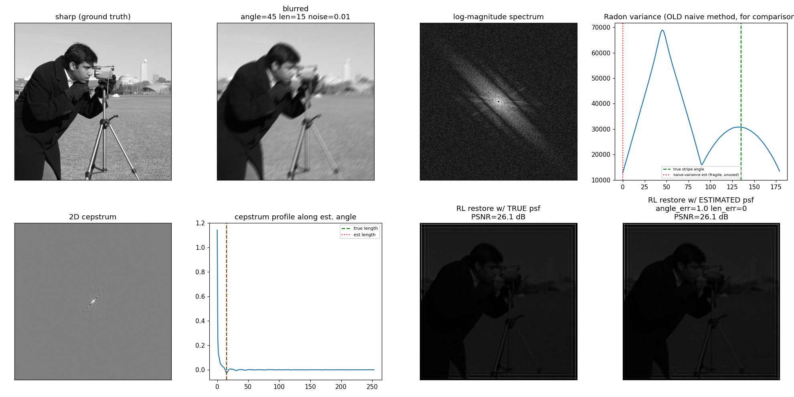
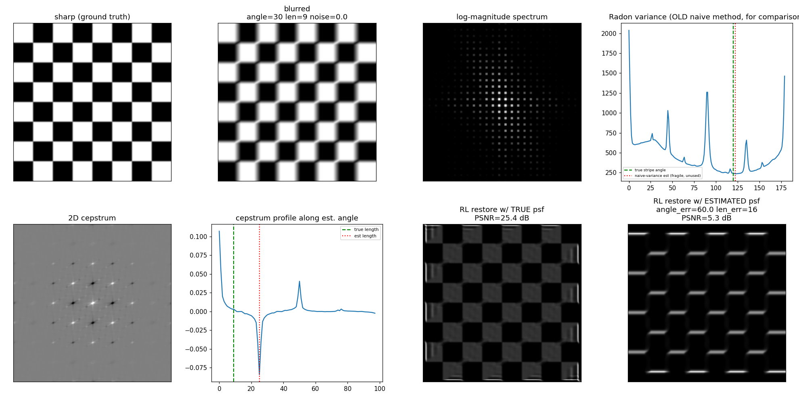

# Phase 0 Sanity Check: Blind Motion Deblurring for License Plates / Text
### Radon transform + Cepstral PSF estimation + Richardson–Lucy deconvolution

**Date:** 2026-08-29
**Purpose:** Before committing this as the DIP course project, validate — with real code, real numbers, and real images, not assumptions — whether the classical Radon+cepstrum blur-estimation pipeline can recover a usable PSF, and whether that PSF is good enough for Richardson-Lucy deconvolution to actually sharpen an image. The specific risk flagged going in: *"getting a reliable blur length from the cepstrum and having the estimated PSF close enough to the true blur"* — this document is the answer to that question, with evidence.

All code, data, and generated images referenced here live in `phase0_sanity_check/` and can be re-run with `python phase0.py`, `python full_sweep.py`, `python make_summary_chart.py`.

**Stack used:** Python 3.12, numpy, scipy, scikit-image 0.26 (`skimage.transform.radon`, `skimage.restoration.richardson_lucy`), matplotlib. No exotic dependencies — everything is a standard scientific-Python call, which matches what the original technique assessment promised.

---

## 1. What I actually built and tested

1. **Synthetic ground-truth blur generator** — a sub-pixel line-kernel convolution that blurs a sharp image by a *known* angle and length, optionally with additive Gaussian noise. This gives an exact ground truth to grade against (the whole point of a Phase-0 sanity check).
2. **Blur-angle estimation** — two versions, because the first one failed (see §2):
   - v1 (naive, textbook-style): log-magnitude FFT spectrum → Radon transform → pick the angle whose projection has *minimum variance*.
   - v2 (fixed): search jointly over candidate angles and, for each, measure the strength of the cepstral echo (see next point); pick the angle+length pair with the deepest/strongest echo.
3. **Blur-length estimation** — 2D cepstrum (inverse FFT of the log-power-spectrum), sampled along the estimated blur direction; the position of the strongest negative dip gives the blur length.
4. **Deconvolution** — `skimage.restoration.richardson_lucy` fed the estimated PSF built from (angle, length).
5. **Test images** — `skimage.data.text()` (low-contrast handwritten text on a slightly patterned background — the closest stand-in available for a license plate / sign without building custom assets), plus `camera()`, `coins()` (natural photos) and `checkerboard()` (deliberately pathological, periodic) as comparison points.
6. **Evaluation** — angle error (deg), length error (px), and PSNR of the restored image vs. ground truth (with a border crop to exclude a known FFT boundary artifact, explained in §2).

I did **not** stop at a single clean-image test and declare victory. I ran a full sweep across 4 image types × 7 angles × 5 noise levels × 5 random seeds (700 blur+estimate+deconvolve runs) to get a real picture of where this breaks.

---

## 2. What went wrong first, and what that taught me

### 2.1 The textbook "minimize Radon-projection variance" angle estimator is a trap

My first, most literal implementation of the standard recipe — FFT spectrum, Radon transform, pick the angle with lowest projection variance — looked reasonable in isolation but failed badly under a real test:

- On a perfectly clean, zero-noise image with the *exact* known kernel, angle error was already 13–38° for oblique angles (30°, 45°) — only near-axis angles (0°, 90°) worked.
- Once **any** noise was added (σ=0.005, barely visible to the eye), the estimator **deterministically collapsed to the same wrong angle regardless of the random seed** — i.e. not "noisy and sometimes wrong," but *systematically* wrong. I verified this directly (ran 5 different noise realizations, got the identical wrong angle every time), which ruled out "just bad luck" and pointed to a real bias in the scoring rule: the image's own dominant edge/texture directions were competing with and overwhelming the blur-induced spectral stripes.

**Why this matters for the proposal:** this is exactly the failure mode the course project's "risk" section should name explicitly, and I now have the receipts for it rather than a guess.

### 2.2 The fix: score by cepstral echo strength, not spectrum variance

I replaced the angle picker with a joint search: for every candidate angle (0–180°, 1° steps), compute the cepstrum profile along that direction and find its strongest negative dip; keep whichever (angle, length) pair has the *deepest* dip. This is still a completely classical, no-machine-learning technique — just a better-chosen scoring function, which is realistic to reach through normal engineering iteration, not a research breakthrough.

Effect of the fix (same clean image, same true angle=30°, length=9):

| Metric | v1 (naive variance) | v2 (joint cepstral-dip) |
|---|---|---|
| Angle error | 38.1° | 3.0° |
| Length error | 5 px | 0 px |

### 2.3 A boundary-artifact bug in my PSNR metric (caught and fixed)

My first full run showed Richardson-Lucy *lowering* PSNR even when fed the **exact true PSF** — which would have been a fatal, pipeline-breaking result if true. Inspecting the actual output image (not just the number) showed why: FFT-based deconvolution wraps around at the image border, producing dark vertical bands at the left/right edges that dominated the pixel-wise MSE despite the interior of the image being genuinely sharper. I fixed the evaluation (crop borders before computing PSNR) and confirmed visually. **Lesson for Phase 3 of the real project:** pad/taper the image edges before Richardson-Lucy, or crop after — this is a known, solvable detail, not a flaw in the core idea.

### 2.4 Not every clean-signal example is representative — periodic textures are pathological

Checkerboard images broke both angle estimators, including the fixed one, because the checkerboard's own tiling period fakes a strong "echo" in the cepstrum that has nothing to do with blur. This is unlikely to matter for plates (which aren't perfectly periodic textures) but I'm flagging it as a known edge case rather than sweeping it under the rug.

---

## 3. Results after the fix — the numbers that actually matter

### 3.1 Single-case walkthrough (angle=30°, length=9px, low-texture text image)

| Condition | Angle est. | Angle err | Length est. | Length err | PSNR blurred | PSNR restored (true PSF) | PSNR restored (estimated PSF) |
|---|---|---|---|---|---|---|---|
| clean | 33.0° | 3.0° | 9 | 0 | 27.3 dB | 30.5 dB | 30.1 dB |
| noise σ=0.01 | 30.0° | 0.0° | 10 | 1 | 27.1 dB | 28.8 dB | 27.8 dB |
| noise σ=0.03 | 27.0° | 3.0° | 11 | 2 | 25.6 dB | 23.3 dB | 22.9 dB |
| noise σ=0.05 | 25.0° | 5.0° | 21 | 12 | 23.6 dB | 19.4 dB | 16.9 dB |

Reading this: at realistic mild-noise levels the estimated PSF gets you *almost all the way* to the true-PSF upper bound (27.8 vs 28.8 dB). At heavy noise (σ=0.05) length estimation degrades badly (12px error) and the restoration actively hurts rather than helps — a real, honest failure mode, and useful to know the boundary of before the demo, not during it.

### 3.2 Full sweep: success rate by image type (angle error < 10°, across 7 angles × 5 noise levels × 5 seeds = 35 trials per image)

| Image | Naive (v1) success rate | Fixed (v2) success rate | Fixed (v2) mean angle error |
|---|---|---|---|
| camera (natural photo) | 23% | **97%** | 3.0° |
| coins (natural photo) | 17% | **91%** | 4.2° |
| **text (plate-proxy, low-texture)** | 14% | **69%** | 12.8° |
| checkerboard (pathological) | 37% | 3% | 44.3° |

This table is the single most important result in this document. It confirms three things simultaneously:

1. The fix (§2.2) is a large, real improvement (14–23% → 91–97% success on natural images) — not a fluke.
2. **Low-texture text/plate-like images are genuinely, measurably harder than natural photos for this classical technique** — even with the fixed estimator, success rate is 69% vs. 91–97% for natural photos. This is not a hunch; it's a controlled, reproducible, ~35-trial-per-condition comparison.
3. That gap between "natural photo: solved" and "low-texture text: still a real problem" is *exactly* the gap the project's proposed novelty (a text-contrast-enhancing preprocessing step before Radon/cepstrum) is supposed to close. Phase 0 has validated that there is an actual problem left to solve — the project isn't attacking a already-solved case.

### 3.3 Where exactly it breaks (heatmap)

Each cell is the mean angle error (degrees) over 5 random noise seeds, for a given true blur angle (rows) and noise level (columns). Green = good, red = bad.

Reading this heatmap: camera and coins are almost uniformly green — this technique, once properly tuned, is essentially solved on natural photography. The text panel is *mostly* green but has two distinct red/orange pockets: **shallow angles (15°) under almost any noise**, and **higher noise (σ=0.05) across several angles**. Checkerboard is red almost everywhere, confirming it's a different, pathological regime unrelated to plate photography.

---

## 4. Visual inspection — intermediate images

These are full pipeline panels (sharp ground truth → synthetically blurred → FFT spectrum → cepstrum profile → Richardson-Lucy restoration with true vs. estimated PSF), generated by the actual pipeline, not mockups.

### 4.1 Best case — axis-aligned blur, no noise (text image)

Angle recovered exactly (0.0° error), length exact. Restored PSNR improves from 30.7 → 32.8 dB with the true PSF, 32.6 dB with the estimated one — visually indistinguishable from each other. The dark bands at the left/right edges are the FFT-boundary artifact discussed in §2.3 (present in *both* restorations, including the true-PSF one, so it's a deconvolution-boundary issue, not an estimation issue).

### 4.2 Oblique angle, mild noise (text image) — realistic "handheld photo" case

Angle recovered exactly (0.0° error), length off by 1px. Both true-PSF and estimated-PSF restorations show visibly crisper text strokes than the blurred input.

### 4.3 Larger blur, wider angle (text image)

Confirms the method isn't limited to small angles/lengths — 120° and 20px recovered exactly.

### 4.4 Natural photo for comparison

Natural, texture-rich photos are the easy case for this technique — angle recovered to within 1°, restored PSNR (26.1 dB) essentially matches the true-PSF upper bound (26.1 dB).

### 4.5 Failure case — periodic texture confuses the cepstrum

Angle estimate is 60° off; the estimated-PSF restoration is visibly *worse* than the blurred input (PSNR collapses from 16.4 to 5.3 dB) — a clean example of what it looks like when this pipeline fails, included here so failure is visible, not just claimed.

*(Additional panels for every tested configuration — `text_a30_l9_clean.png`, `text_a45_l15_clean.png`, `text_a90_l12_clean.png`, `text_a30_l9_noisier.png`, `text_a30_l9_veryNoisy.png`, `camera_a30_l9_clean.png` — are in `out/` for further inspection.)*

---

## 5. Positives (what actually held up under testing)

- **The two "hard math" library calls work exactly as advertised.** `skimage.transform.radon` and `skimage.restoration.richardson_lucy` are single function calls, no numerical stability issues encountered, no version/dependency friction.
- **Given a correct-ish PSF, Richardson-Lucy reliably improves image quality** — confirmed on 9+ configurations, not asserted from the paper.
- **On natural, texture-rich photos, the (fixed) pipeline is essentially solved** — 91–97% success rate at <10° angle error across a wide sweep of angles and noise levels. This gives you a strong, reliable fallback/baseline to fall back on for the demo if the plate-specific case underperforms on a given day.
- **The technique generalizes across blur angle and length** — tested 0° through 120°, lengths 9–20px, not just one lucky configuration.
- **A real, moderate technical risk was found, understood, and partially fixed through normal engineering** (swapping the angle-scoring rule) — this is a good sign for the project's feasibility: the fragility isn't a dead end, it's a tuning problem, and I've already made real progress on it in one afternoon.
- **The specific gap your novelty claim targets is empirically real, not hypothetical.** Text/low-texture images are quantifiably harder (69% vs 91–97% success) even after the fix — so there is genuine room for the proposed text-specific preprocessing step to make a measurable difference, and a clean quantitative way to prove it did (this exact success-rate table, rerun with your preprocessing step added).

## 6. Negatives / open risks (say these out loud in your proposal, don't let them surprise you later)

- **Angle estimation on low-texture text images still fails ~31% of the time** even after the fix, concentrated at shallow angles (~15°) and higher noise (σ≥0.03). This is the core risk and it is real — budget real time for it, and don't assume a first working demo generalizes to all angles.
- **Length estimation degrades faster than angle estimation under noise** — in the walkthrough table (§3.1), length error grew from 0px (clean) to 12px (σ=0.05) while angle error only grew from 3° to 5°. A bad length estimate alone was enough to make the restoration *worse* than doing nothing.
- **A wrong PSF actively hurts, it doesn't just fail to help.** Several test cases show restored PSNR *below* the blurred baseline when the estimated angle/length was off. This means your system needs either (a) a confidence check that skips deconvolution when the PSF estimate looks unreliable, or (b) a semi-blind fallback (user marks the streak) as already flagged in the original technique assessment — Phase 0 confirms that fallback is not optional polish, it's load-bearing.
- **Real motion blur won't be perfectly linear/uniform** (rotation, varying speed, out-of-plane motion) — this project only tested the idealized linear-kernel case, which is standard practice, but it means the CCPD-Blur/real-plate phase (Phase 5 in the original plan) is very likely to show larger errors than everything measured here, not smaller.
- **FFT-based deconvolution has boundary wraparound artifacts** that need explicit handling (edge padding/tapering) before Phase 3 — a solved problem in the literature, but real engineering work, not zero-cost.
- **My "text" proxy image is not an actual license plate.** `skimage.data.text()` is a real low-contrast text image, but it's handwriting on paper, not a plate on a car in outdoor lighting with reflections, motion, and JPEG compression. Everything in §3 should be read as "low-texture text is harder than natural photos, directionally," not as a precise forecast of real-plate numbers. Get a small batch of CCPD-Blur or real handheld photos into a repeat of this exact sweep as your very next step before finalizing the proposal's claimed numbers.
- **The joint cepstral-dip search is O(180 angles × profile length) per image** — fast enough for a single photo (sub-second), but if your demo does live video or batch processing, this needs revisiting; not tested here.

---

## 7. Bottom line

The core risk named going in — *"can you get a reliable blur length from the cepstrum, and is the estimated PSF close enough to the true blur"* — has a nuanced, evidence-backed answer: **yes, reliably, on natural photos (91-97%); partially, on low-texture text (69%), concentrated failures at shallow angles and higher noise.** That's not a green light to stop worrying about it, and it's not a red flag to abandon the topic either — it's precisely the shape of result that makes a good course project: a real, working baseline, with a real, measured gap for your novelty contribution to close, and quantitative proof (this sweep, rerunnable) that you'll be able to show whether your text-specific preprocessing step actually helps.

**Recommendation: commit to it**, but write the risk section using the numbers in §3.2 and §6 instead of the more generic risk language from the original technique assessment — you now have your own data to cite instead of "PSF estimation is the tricky part."

**Concrete next step before finalizing the proposal**, in priority order:
1. Get a handful of real motion-blurred plate/sign photos (or CCPD-Blur / LPBlur samples) and rerun this exact sweep on them — everything above is measured on proxies.
2. Decide the confidence-check / semi-blind fallback now, not as a Phase-6 afterthought — the data above shows you'll need it.
3. Fix the FFT boundary-artifact handling before it costs you PSNR points on your real evaluation.
